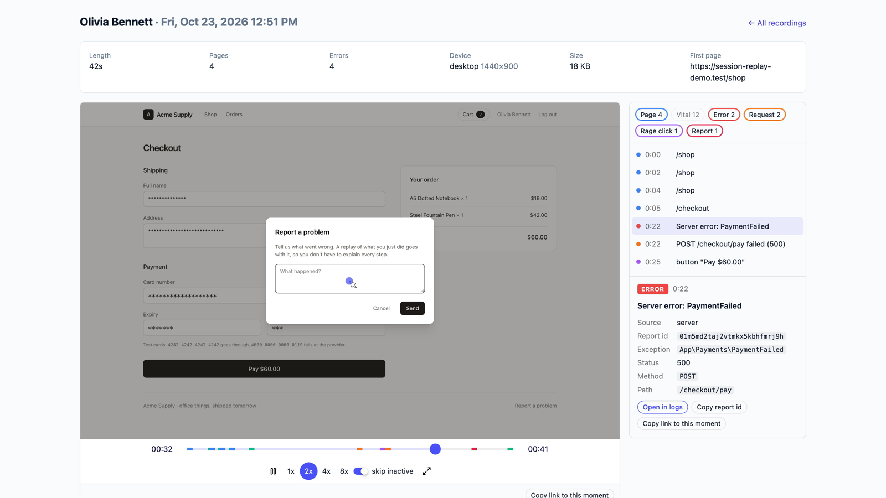

# Session Replay for Laravel: demo app

A small Laravel 13 shop, **Acme Supply**, wired to [Session Replay for Laravel](https://github.com/packstub/session-replay) (`packstub/session-replay`). Customers are recorded while they shop. Support watches the replays in the package's built-in viewer and jumps from a server error straight to its line in the log, and from the log line back to the replay.

The shop has one bug on purpose. When the payment provider fails, the checkout's JavaScript only stops the spinner, so the customer sees a Pay button that seems to do nothing. The replay shows what they went through, and the error marker's report id finds the exception in [Log Viewer](https://github.com/opcodesio/log-viewer).



## Run it

You need PHP 8.3+, Composer and Node 20+.

```bash
git clone https://github.com/packstub/session-replay-demo.git
cd session-replay-demo
composer install
cp .env.example .env
php artisan key:generate
touch database/database.sqlite
npm install && npm run build
npx playwright install chromium
```

Start the app, then make some recordings in a second terminal:

```bash
php artisan serve
composer demo        # migrate:fresh --seed, then real visits in a headless browser
```

`composer demo` signs in as four customers and uses the shop, with the recorder running as it would for a person. Olivia's visit is the interesting one: her card fails at the provider, she clicks Pay again and again, then she reports the problem. `HEADED=1 composer demo` lets you watch.

Open http://localhost:8000 and click **Support** under "Developer logins": you land on `/session-replay`. The buttons are [Account Switcher](https://github.com/packstub/account-switcher)'s developer logins, shown in the `local` environment only; the password works too.

| Account | Password | |
| --- | --- | --- |
| `support@acme.test` | `password` | watches the replays, opens the logs |
| `olivia@acme.test` (also `marcus@`, `priya@`, `tom@`) | `password` | customers, recorded |

Prefer to break it yourself? Sign in as a customer, add something to the cart and pay with `4000 0000 0000 0119` (`4242 4242 4242 4242` goes through). Then click **Report a problem** in the footer.

## Where to look

Setting up Session Replay here took a handful of lines. These are the files where it happens:

| File | What it does |
| --- | --- |
| [`resources/views/components/layouts/app.blade.php`](resources/views/components/layouts/app.blade.php) | `@sessionReplay` before `</body>`: the recorder, its config and the signed token |
| [`app/Providers/SessionReplayServiceProvider.php`](app/Providers/SessionReplayServiceProvider.php) | who may watch (the `viewSessionReplay` gate), who is recorded (`recordWhen`), the "Open in logs" link (`logUrlUsing`), and a listener for `ReplayReported` |
| [`resources/js/app.js`](resources/js/app.js) | the checkout with the bug, and `SessionReplay.send()` behind "Report a problem" |
| [`config/session-replay.php`](config/session-replay.php) | the published config; the demo changes `viewer.user_label` to `name` and turns on `viewer.autoplay` |
| [`app/Payments/PaymentGateway.php`](app/Payments/PaymentGateway.php) | a stand-in for a payment provider, with the test cards above |
| [`app/Logging/ReplayLaravelLog.php`](app/Logging/ReplayLaravelLog.php), [`LinkReplaysInLogViewer`](app/Http/Middleware/LinkReplaysInLogViewer.php), [`replay-links`](resources/views/log-viewer/replay-links.blade.php) | a Replay column in Log Viewer: the replay link Session Replay adds to each log line's context, as a "Watch replay" button |
| [`app/Logging/RelativePaths.php`](app/Logging/RelativePaths.php) | stack traces in the log with paths relative to the app |
| [`scripts/record-sessions.mjs`](scripts/record-sessions.mjs) | the Playwright visits behind `composer demo` |

Recordings go to `storage/app/private/session-replay` (gzip chunks) and to a few tables in the app's database. The package's docs cover everything else: masking, consent, recording only when something goes wrong, multi-tenant apps and storage on S3. They're on [packstub.dev/docs/session-replay](https://packstub.dev/docs/session-replay).

## Tests

```bash
composer test
```

## License

MIT. See [LICENSE.md](LICENSE.md).
